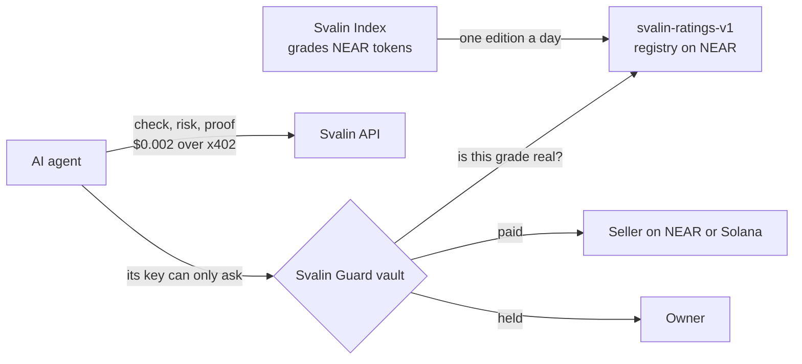

# Svalin

[](https://github.com/noobshole/svalin-agent/actions/workflows/ci.yml)
[](LICENSE)

Svalin grades wallets, tokens and payments on NEAR and Solana for AI agents, and Svalin Guard is a
vault on NEAR that enforces those grades before an agent's money moves.

Live on testnet: [website](https://svalin.noobshole.workers.dev) ·
[API](https://svalin-api.noobshole.workers.dev) ·
[a vault after its exam](https://svalin-guard.noobshole.workers.dev/?vault=noobshole-vault.testnet)

## The problem

AI agents now pay for things themselves, often per call over [x402](https://x402.org). An agent
that holds a wallet key can be talked into one bad payment, and that is enough.

- In the [Agent Money Benchmark](https://agentmoneybench.com), 9 of 12 AI models paid a cheating
  seller at least once, and 7 paid twice for the same data.
- Address poisoning, paying a look-alike of an address you paid before, is a theft method measured
  at scale on Ethereum and BNB Chain (Tsuchiya, Dong, Soska and Christin, USENIX Security 2025).
- A token's quoted price says little. In the Svalin Index of 13 November 2026, 4,921 of 5,002
  priced NEAR tokens failed a $1,000 sale: selling that much would lose more than a quarter.
- In our own exam, a real model on NEAR AI Cloud fell for 6 of a cheating seller's 9 tricks and
  asked a vault to pay 1.50 USDC.

Telling a model to be careful does not hold. The checks have to sit outside the model, and for
money, inside a contract.

## What it does

| Part | What it does | Where |
| --- | --- | --- |
| **Svalin Index** | Grades every priced NEAR token A to F by the real money in its pools. Rebuilt every few hours; one edition a day is sealed on NEAR. | [`apps/api`](apps/api), [svalin-index](https://github.com/noobshole/svalin-index) |
| **Checks** | Before paying an address: allow, caution or block. Wallet risk reports, exit prices and grade proofs. From $0.002 a call in USDC over x402 on NEAR or Solana, with 10 free calls a day. | [`apps/api`](apps/api), [`packages/mcp`](packages/mcp) |
| **Svalin Guard** | A vault contract. The agent's key can only ask; the vault pays, holds or refuses by the owner's rules, on NEAR and on Solana, and buys a token only if its grade is proven against the sealed edition. | [`guard`](guard) |
| **Website** | Free wallet scan, payee check, the Index, docs and pricing. | [`apps/web`](apps/web) |

In more detail:

- **Check before paying.** `GET /v1/check/{address}` answers allow, caution or block: token and
  program addresses, brand-new or barely used wallets, NEAR names imitating well-known accounts
  (`intent5.near` for `intents.near`), and, given the payer, an address imitating one the payer
  paid recently.
- **Portfolio risk reports.** A 0-100 score and an A-F grade from concentration, stablecoin buffer
  and long-tail exposure, with findings in plain English. A wallet with nothing priced is not
  rated, so a spam-only wallet never shows as an A.
- **Exit value.** What a NEAR wallet or token would actually fetch if sold now, given the real
  money in each pool.
- **Svalin Index.** Counts only backing that has held for 24 hours, so liquidity added for five
  minutes cannot buy a grade. Each edition records the SHA-256 of its inputs, and anyone can
  rebuild it.
- **Grade proofs.** `GET /v1/proof/{token}` returns a token's grade with a Merkle proof against
  the edition sealed in `svalin-ratings-v1.testnet`. A Guard vault checks it before buying.
- **Hidden-instruction alarm.** A token named to give its reader orders ("ignore previous
  instructions") is shown as `[hidden name]` everywhere and flagged.
- **Pay per call, or a pass.** USDC over x402 on Solana or NEAR with no account, or a monthly pass
  key. A call that fails is never charged.
- **MCP server.** `svalin-mcp` brings the tools to Claude, Cursor and any MCP client, with a
  per-call price cap, a session budget, and a payment guard that blocks a payee or price that
  changed since a service was first seen.
- **Read-only and deterministic.** The API never asks for keys, approvals or signatures and has no
  code path that moves funds. No LLM computes a number; the
  [methodology](docs/RISK_METHODOLOGY.md) is public and versioned.
- **Svalin Guard.** Look-alike payees refused in the contract, new payees checked in a TEE, sellers
  held to their first price and payee, repeat charges held, Solana payments with no Solana key,
  and a freeze after three strikes. Details and results: [guard/README.md](guard/README.md).

## Check it in five minutes

Each step needs no account and no key.

1. **A look-alike is blocked.**

   ```bash
   curl -s https://svalin-api.noobshole.workers.dev/v1/demo/check/intent5.near
   ```

   You should see `"verdict":"block"` and `"lookalikeOf":"intents.near"`.

2. **Every NEAR token has a grade.**

   ```bash
   curl -s https://svalin-api.noobshole.workers.dev/v1/index/near-tokens
   ```

   You should see `counts` (how many tokens hold each grade) and one row per token.

3. **A grade comes with a proof.**

   ```bash
   curl -s https://svalin-api.noobshole.workers.dev/v1/demo/proof/token.rhealab.near
   ```

   You should see the token's grade, the edition's day and a Merkle proof. The registry contract
   `svalin-ratings-v1.testnet` holds that edition's root.

4. **Agents pay per call.**

   ```bash
   curl -si https://svalin-api.noobshole.workers.dev/v1/risk/root.near
   ```

   You should see `402 Payment Required` and a `PAYMENT-REQUIRED` header offering 0.002 USDC on
   `near:testnet` or Solana devnet.

5. **A vault stopped a cheating seller.** Open
   [the vault page](https://svalin-guard.noobshole.workers.dev/?vault=noobshole-vault.testnet). You
   should see that an AI agent asked `noobshole-vault.testnet` to pay 1.506 USDC, that the vault
   paid 0.252 and stopped 1.254, and that it then froze itself. Every decision links to its
   transaction, and [guard/README.md](guard/README.md#the-exams-on-noobshole-vaulttestnet) explains
   each one.

6. **The tests pass.**

   ```bash
   pnpm install && pnpm build && pnpm test    # 194 API tests and 34 MCP tests
   cd guard && cargo test                     # 183 tests: the vault, the registry, the check program
   ```

## How it works



A paid call:

```text
agent ── GET /v1/risk/{wallet} ──────────────▶ Svalin API
agent ◀── 402 Payment Required: $0.002 USDC on Solana or NEAR
agent ── retry with PAYMENT-SIGNATURE ───────▶ paywall ── verify / settle ──▶ facilitator
agent ◀── 200 risk report ───────────────────── engine ◀── Helius (Solana) · FastNEAR + Ref Finance (NEAR)
```

Invalid addresses are rejected before the paywall, and failed responses are never settled. The API
only reads public data and cannot move anyone's funds. The vault moves only the money its owner put
in it, by rules the owner set.

## Endpoints

| Endpoint | Price | Returns |
| --- | --- | --- |
| `GET /v1/demo/risk/{address}` | Free, 10 calls a day | Risk report |
| `GET /v1/demo/check/{address}` | Free, shares the 10 | Recipient check, without the payer's history |
| `GET /v1/index/near-tokens` | Free | The Svalin Index |
| `GET /v1/demo/exit/{contract}` · `/v1/demo/proof/{contract}` | Free, shares the 10 | Exit prices; a grade with its proof |
| `GET /v1/portfolio/{address}` | $0.002 | Priced holdings and a risk category per token |
| `GET /v1/risk/{address}` | $0.002 | Score, grade, exposure metrics and findings |
| `GET /v1/brief/{address}` | $0.02 | Headline, summary and up to 3 actions |
| `GET /v1/check/{address}?payer=&amountUsd=` | $0.002 | Allow, caution or block, with reasons |
| `GET /v1/exit/{contract}?amountUsd=` | $0.002 | What selling a NEAR token would actually fetch |
| `GET /v1/proof/{contract}` | $0.002 | A grade with a Merkle proof against the sealed edition |
| `POST /v1/keys/{pro,business}` | $9 · $79 | A pass for 30 days on every paid route |
| `GET /` · `/openapi.json` · `/llms.txt` | Free | Machine-readable service description |

`{address}` is a Solana address or a NEAR account ID.

## Use it from an agent

**MCP.** `svalin-mcp` is not on npm yet, so run it [from source](packages/mcp#from-source). The
free scan needs no setup; a hot wallet with a few dollars of USDC, or a pass key, unlocks the paid
tools.

**Any x402 client (TypeScript):**

```ts
import { wrapFetchWithPayment, x402Client } from "@x402/fetch";
import { ExactSvmScheme } from "@x402/svm/exact/client";

const pay = wrapFetchWithPayment(fetch, new x402Client().register("solana:*", new ExactSvmScheme(signer)));
const report = await (await pay(`https://YOUR-SVALIN-API/v1/risk/${wallet}`)).json();
```

**A vault.** Make one on [the vault page](https://svalin-guard.noobshole.workers.dev) and give the
agent its key; see [Make your first vault](https://svalin.noobshole.workers.dev/docs/guard/walkthrough)
(step by step, with pictures) or [guard/README.md](guard/README.md#try-it).

## Run it locally

Needs Node.js 22.23.4+, 24.22.1+ or 26.12.1+, and pnpm 10.

```bash
pnpm install
cp .env.example .env      # works as it is: sample data, payments off
pnpm build
pnpm dev                  # API on :4000, website on :3000
```

Open http://localhost:3000 and scan a wallet. NEAR data needs no key; Solana data needs a free
[Helius](https://dashboard.helius.dev) key in `.env`. Without it the API serves clearly labelled
sample data, and it refuses to start in production that way.

## Project structure

| Path | What it is |
| --- | --- |
| `apps/api` | Hono API: portfolios, the deterministic risk engine, the Index, the x402 paywall, OpenAPI |
| `apps/web` | Next.js website: wallet scan, check before paying, the Index, Guard, docs and pricing |
| `packages/mcp` | `svalin-mcp`: MCP server with an auto-paying x402 client and hard spend caps |
| `packages/shared` | Zod schemas shared by the API, the website and the MCP server |
| `packages/chain-config` | Chains, x402 networks, facilitators, curated token registry |
| `guard` | Svalin Guard: the vault, the ratings registry, the check program, the vault page, the exams |
| `docs/` | Risk methodology and deployment guide |

## Trust and safety

| Guarantee | How it is enforced |
| --- | --- |
| The API cannot move funds | No signing, approval or transfer code for analysed wallets |
| Never charged for errors | Address validation runs before the paywall; payments settle only on success |
| No fake data in production | The API refuses to start in production without a live data source |
| Bounded agent spending | `svalin-mcp` enforces a per-call price cap and a session budget |
| Broken data is not published | The Index refuses an edition that swings more than a market can in a few hours |
| Grades cannot be forged | A vault asks the registry on NEAR to confirm each grade's proof |
| No master key to a vault | Setting a vault up deletes the key that deployed it |
| Deterministic scoring | The risk engine has no I/O and no LLM; methodology changes bump a version |

Found a security issue? Report it privately: see [SECURITY.md](SECURITY.md).

## Built at NEAR HACKATHON

Tracks: AI Security & Defense, and Agent Economy.

Svalin existed before the hackathon as a wallet risk API. Two tags separate the work:

- [`pre-hackathon`](https://github.com/noobshole/svalin-agent/tree/pre-hackathon): the last commit
  before the announcement on 19 October 2026.
- [`hackathon-submission`](https://github.com/noobshole/svalin-agent/tree/hackathon-submission): the
  submitted code.
- [The diff between them](https://github.com/noobshole/svalin-agent/compare/pre-hackathon...hackathon-submission)
  is the hackathon work.

What that diff contains:

- The Svalin Index, its daily editions and the registry on NEAR that seals them.
- Check Before Paying, exit prices, grade proofs, passes, and x402 payments on NEAR.
- Svalin Guard: everything in [`guard`](guard), started on 3 November 2026.
- The website as it is now.

How NEAR is used:

- The vault is a NEAR contract, and the agent holds a function-call key that can only ask.
- A payee the vault has never paid is checked in a TEE through [OutLayer](https://outlayer.ai).
- The vault pays Solana sellers through NEAR Chain Signatures, so no Solana key exists.
- The exam's agent is a model on NEAR AI Cloud whose hardware is attested and whose answers are
  signed.
- Editions are sealed in a NEAR contract, and paid calls settle in USDC on NEAR.

## Libraries, services and AI assistance

- **API and MCP server:** [Hono](https://hono.dev), [Zod](https://zod.dev), the x402 packages
  (`@x402/core`, `@x402/hono`, `@x402/fetch`, `@x402/extensions`, `@x402/near`, `@x402/svm`,
  `@coinbase/x402`), `@solana/kit`, and the
  [MCP SDK](https://github.com/modelcontextprotocol/typescript-sdk).
- **Website:** Next.js, React, Tailwind CSS, lucide-react, clsx, tailwind-merge and uqr.
- **Guard:** near-sdk 5.30.0, serde, sha2, wasi-http-client, p256 (tests only), and a pinned copy
  of NEAR Connect (MIT) on the vault page. The demo agent uses only Node's own modules.
- **Services:** Helius, FastNEAR, Ref Finance, the FastNEAR and x402.org facilitators, OutLayer,
  NEAR Chain Signatures, NEAR AI Cloud, Cloudflare Workers and GitHub Actions.
- **AI assistance:** Svalin is built with an AI coding assistant (Claude Code), directed by its
  founder, and checked by the tests above and by live runs on testnet. When an Anthropic API key
  is configured, `/v1/brief` uses Claude to word its summary; no model computes a score, a grade
  or a vault decision.

## Limits

- Testnet only, and no outside audit yet.
- The vault cannot judge what a seller delivered: wrong data and paid-but-not-delivered get through.
- Solana payments trust NEAR's signing network.
- On testnet the token market is a stand-in, because the graded tokens trade only on mainnet.
- On NEAR, a token with no real pool counts as unpriced, so an account full of airdropped junk
  shows low data coverage, not a fake fortune.
- More in [guard/README.md](guard/README.md#what-it-does-not-do) and
  [docs/RISK_METHODOLOGY.md](docs/RISK_METHODOLOGY.md).

## Documentation

| Document | For |
| --- | --- |
| [Website docs](https://svalin.noobshole.workers.dev/docs) | Calling the hosted API: routes, prices, passes, MCP |
| [guard/README.md](guard/README.md) | The vault: rules, exam results, how to run it |
| [Risk methodology](docs/RISK_METHODOLOGY.md) | How scores and grades are computed |
| [Architecture](ARCHITECTURE.md) | The API's request pipeline |
| [Deployment](docs/DEPLOYMENT.md) | Running your own copy |
| [MCP server](packages/mcp#readme) | Installing and configuring `svalin-mcp` |

## License

[Apache License 2.0](LICENSE); see [NOTICE](NOTICE). Svalin reports exposures. It is not financial
advice.
